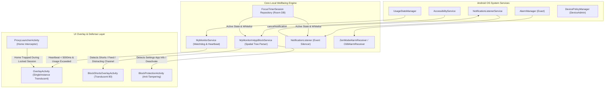
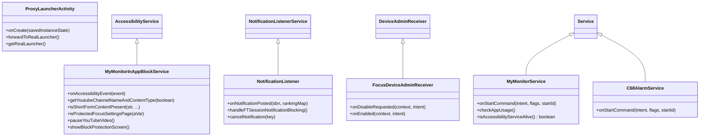
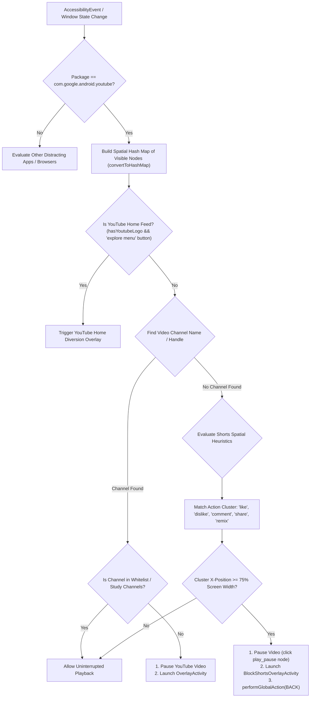
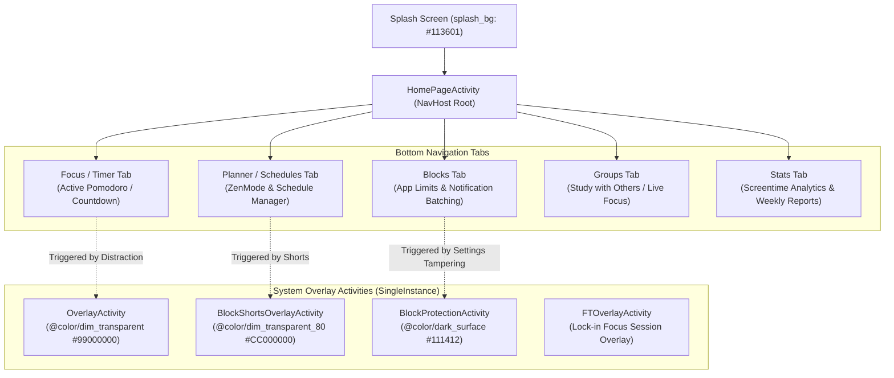

# Architectural Blueprint: Focus Android Digital Wellbeing & App Blocker Engine
*First-Party Production Architecture Specification for Focus (`com.personal.focus`)*

---

## 1. Executive Architectural Overview

The target application is architectured around a dual-layer Android background enforcement system:
1. **Low-Latency Structural Watchdog Layer:** A persistent Foreground Service (`MyMonitorService` & `C68AlarmService`) paired with `UsageStatsManager` and high-priority alarms (`AlarmManager`).
2. **Real-Time UI & In-App Content Inspection Layer:** An `AccessibilityService` (`MyMonitorInAppBlockService`) that performs spatial node graph analysis of active third-party windows (YouTube, Instagram, Chrome, and Android Settings).
3. **Notification Interception Layer:** A `NotificationListenerService` (`NotificationListener`) that suppresses and cancels incoming distracting notifications in real time.
4. **Anti-Tampering & Anti-Uninstall Layer:** A `DeviceAdminReceiver` (`FocusDeviceAdminReceiver`) paired with Accessibility node heuristics to block Settings App Info (`Force Stop`, `Uninstall`, `Deactivate Admin`).
5. **Launcher Interceptor:** A `CATEGORY_HOME` Proxy Launcher (`ProxyLauncherActivity`) that traps home button navigation during active lockouts.
6. **Overlay Presentation:** Transparent, single-instance Compose activities (`OverlayActivity`, `BlockShortsOverlayActivity`, `FTOverlayActivity`) loaded with `@anim/no_animation` to preemptively intercept the user.



---

## 2. Manifest & System Services Blueprint

### 2.1 Complete Android Permissions Inventory

| Permission | Category | Architectural Purpose |
| :--- | :--- | :--- |
| `android.permission.PACKAGE_USAGE_STATS` | System Special App Access | Required by `UsageStatsManager` to poll foreground apps, calculate daily screentime, and detect app launches. |
| `android.permission.SYSTEM_ALERT_WINDOW` | System Special App Access | Displaying floating timer widgets (`FTOverlayService`, `PMFloatingButtonService`) and system-level alerts. |
| `android.permission.BIND_ACCESSIBILITY_SERVICE` | Privileged System Bind | Required by `MyMonitorInAppBlockService` to inspect active window view trees, node bounds, and text. |
| `android.permission.BIND_NOTIFICATION_LISTENER_SERVICE` | Privileged System Bind | Required by `NotificationListener` to intercept and cancel notifications posted by blocked applications. |
| `android.permission.BIND_DEVICE_ADMIN` | Privileged System Bind | Required by `FocusDeviceAdminReceiver` to hook `onDisableRequested` and prevent app uninstallation. |
| `android.permission.SCHEDULE_EXACT_ALARM` | Alarms | Schedules exact millisecond alarm triggers for Pomodoro intervals and From/To schedule transitions. |
| `android.permission.USE_EXACT_ALARM` | Alarms | Android 13+ exact alarm declaration ensuring schedule accuracy. |
| `android.permission.RECEIVE_BOOT_COMPLETED` | Broadcast | Restores scheduled alarms and restarts background watchdog services when device reboots. |
| `android.permission.FOREGROUND_SERVICE` | Service | Keeps monitoring services running in RAM without OS killing. |
| `android.permission.FOREGROUND_SERVICE_SPECIAL_USE` | Service | Android 14 foreground service type for continuous wellbeing monitoring. |
| `android.permission.FOREGROUND_SERVICE_MEDIA_PLAYBACK` | Service | Audio chime / bell playback for focus session completion. |
| `android.permission.REQUEST_IGNORE_BATTERY_OPTIMIZATIONS` | Battery / Power | Whitelists app against aggressive OEM battery killers (MIUI, Samsung, ColorOS). |
| `android.permission.QUERY_ALL_PACKAGES` | Package Visibility | Queries installed third-party apps to build selectable distracting apps and whitelist pickers. |
| `android.permission.POST_NOTIFICATIONS` | Notifications | Android 13+ runtime permission to display persistent foreground notifications. |
| `android.permission.USE_FULL_SCREEN_INTENT` | Notification Alert | High-priority overlay wake-ups for alarms and timer completions. |
| `android.permission.WAKE_LOCK` | Power | Ensures CPU stays awake briefly while evaluating block transitions. |

---

### 2.2 System Services & Components



#### Detailed Declarations from Manifest:

```xml
<!-- 1. Accessibility Service for In-App UI Inspection -->
<service
    android:name="com.personal.focus.services.MyMonitorInAppBlockService"
    android:permission="android.permission.BIND_ACCESSIBILITY_SERVICE"
    android:exported="true">
    <intent-filter>
        <action android:name="android.accessibilityservice.AccessibilityService" />
    </intent-filter>
    <meta-data
        android:name="android.accessibilityservice"
        android:resource="@xml/accessibility_service_config" />
</service>

<!-- 2. Notification Interception Service -->
<service
    android:name="com.personal.focus.NotificationListener"
    android:permission="android.permission.BIND_NOTIFICATION_LISTENER_SERVICE"
    android:exported="true">
    <intent-filter>
        <action android:name="android.service.notification.NotificationListenerService" />
    </intent-filter>
</service>

<!-- 3. Foreground Watchdog & Usage Monitor Service -->
<service
    android:name="com.personal.focus.services.MyMonitorService"
    android:exported="true"
    android:foregroundServiceType="specialUse" />

<!-- 4. Schedule Occurrence Alarm Service -->
<service
    android:name="com.personal.focus.feature_c68.alarm.C68AlarmService"
    android:exported="false"
    android:foregroundServiceType="specialUse" />

<!-- 5. Uninstall Protection Device Administrator -->
<receiver
    android:name="com.personal.focus.broadcastReceivers.FocusDeviceAdminReceiver"
    android:permission="android.permission.BIND_DEVICE_ADMIN"
    android:exported="true">
    <meta-data
        android:name="android.app.device_admin"
        android:resource="@xml/device_admin" />
    <intent-filter>
        <action android:name="android.app.action.DEVICE_ADMIN_ENABLED" />
        <action android:name="android.app.action.DEVICE_ADMIN_DISABLE_REQUESTED" />
        <action android:name="android.app.action.DEVICE_ADMIN_DISABLED" />
    </intent-filter>
</receiver>

<!-- 6. Schedule Alarm Receiver -->
<receiver
    android:name="com.personal.focus.broadcastReceivers.ZenModeAlarmReceiver"
    android:exported="false">
    <intent-filter>
        <action android:name="android.intent.action.BOOT_COMPLETED" />
    </intent-filter>
</receiver>

<!-- 7. Clock & Boot Tampering Restorers -->
<receiver
    android:name="com.personal.focus.broadcastReceivers.TimeChangedReceiver"
    android:exported="false" />
<receiver
    android:name="com.personal.focus.broadcastReceivers.TimeZoneChangedReceiver"
    android:exported="false" />
<receiver
    android:name="com.personal.focus.feature_c68.alarm.C68AlarmRestoreReceiver"
    android:exported="false">
    <intent-filter>
        <action android:name="android.intent.action.BOOT_COMPLETED" />
        <action android:name="android.intent.action.TIME_SET" />
        <action android:name="android.intent.action.TIMEZONE_CHANGED" />
    </intent-filter>
</receiver>

<!-- 8. Proxy Home Launcher Interceptor -->
<activity
    android:name="com.personal.focus.ProxyLauncherActivity"
    android:enabled="false"
    android:exported="true"
    android:taskAffinity=":proxyLauncher"
    android:excludeFromRecents="true"
    android:noHistory="true"
    android:theme="@android:style/Theme.Translucent.NoTitleBar">
    <intent-filter>
        <action android:name="android.intent.action.MAIN" />
        <category android:name="android.intent.category.HOME" />
        <category android:name="android.intent.category.DEFAULT" />
    </intent-filter>
</activity>
```

---

## 3. Core Blocking & Ultra Focus Logic

### 3.1 Timer, Pomodoro & Schedule Execution Engine

The core schedule model is represented by two Room database entities: `ZenModeConfig` (the schedule template) and `FocusTimerSession` (the active runtime session instance).

#### `FocusTimerSession` Runtime Model (`com.personal.focus.feature_focus_timer.domain.model.FocusTimerSession`):
```kotlin
@Entity(tableName = "focus_timer_session")
data class FocusTimerSession(
    @PrimaryKey val sessionId: Int,
    val startTime: Long,                     // Epoch millis of session start
    val durationInMillis: Long?,             // Total planned duration
    val mode: FocusMode,                     // POMODORO | STOPWATCH | COUNTDOWN
    val isLockedIn: Boolean,                 // STRICT MODE ACTIVE FLAG
    val disableEndButtonShown: Boolean,      // Hides "Give Up" button
    val isUninstallBlocked: Boolean,         // Enforces DeviceAdmin & Settings protection
    val isLauncherBlocked: Boolean,          // Enforces Home screen lockout
    val blockNotifications: Boolean,         // Triggers NotificationListener suppression
    val breaksAllowedCount: Int,             // E.g. 0 for Strict Mode
    val breaksTakenCount: Int,
    val breakDurationInMillis: Long,         // Short break length (e.g. 5 mins)
    val longBreakDurationInMillis: Long,     // Long break length (e.g. 15 mins)
    val roundsPerCycle: Int,                 // Pomodoro rounds before long break (e.g. 4)
    val breakExpiryTime: Long?,              // If currently in break, timestamp when break ends
    val sessionStatus: SessionStatus         // ACTIVE | PAUSED | COMPLETED | CANCELLED
)
```

#### Schedule Time & Active Days Model (`com.personal.focus.ZenModeDefaultConfig`):
- **Start Time:** Represented as `startTimeInMins` (integer `0` to `1439`, elapsed minutes from midnight: `hour * 60 + minute`).
- **Duration:** `durationInMins` (integer minutes).
- **Active Days:** Serialized as comma-separated days or bitmask: e.g. `"1,2,3,4,5"` (Monday through Friday).
- **Overnight Schedules:** Checked via `spansOvernight` boolean (`(startTimeInMins + durationInMins) >= 1440`).
- **Alarm Scheduling:** Calculated using `AlarmManager.setExactAndAllowWhileIdle(RTC_WAKEUP, triggerTime, pendingIntent)`. When alarms fire, `ZenModeAlarmReceiver` checks if the current day matches the active days bitmask before starting the block session.

---

### 3.2 Strict Mode & Lock State Mechanics

Strict Mode (internally termed `isLockedIn`) enforces irreversible session completion through multi-layer barriers:
1. **Give Up Delay / Elimination:**
   - In standard mode, a delay countdown (`endSessionWaitTimeInSecs`, e.g., 10s to 60s) is enforced before user can exit.
   - In Strict Mode (`isLockedIn = true` and `disableEndButtonShown = true`), the "End Session" action is completely disabled in the UI.
2. **Break Restrictions:**
   - `breaksAllowedCount = 0`: Disables the "Take Break" button entirely.
   - If breaks are permitted, `breakWaitTimeInSecs` enforces a mandatory wait delay before a break can begin.
3. **App Limit & Schedule Immutability:**
   - When Strict Mode is active, any attempt to edit the schedule, add apps to the whitelist, change active hours, or delete the rule is rejected (`cant_turn_off_strict_mode_active: "Can't turn off while Strict Mode is active."`).
4. **Time Tampering Defense:**
   - `TimeChangedReceiver` and `TimeZoneChangedReceiver` listen for `ACTION_TIME_SET` and `ACTION_TIMEZONE_CHANGED`.
   - The engine validates elapsed time against `SystemClock.elapsedRealtime()` (which cannot be manipulated by changing system date/time) rather than `System.currentTimeMillis()`.

---

### 3.3 YouTube Study Mode & Shorts Detection Heuristics

The YouTube filtering engine inside `MyMonitorInAppBlockService` is one of the most sophisticated in-app inspection architectures on Android.

#### Detection Hierarchy & Node Inspection Flow:



#### Detailed YouTube Inspection Code Traces (`single_service.java`):

1. **Player Control View IDs:**
   ```java
   // Pause / Play Button Node IDs searched in active window
   rootInActiveWindow.findAccessibilityNodeInfosByViewId("com.google.android.youtube:id/player_control_play_pause_replay_button");
   rootInActiveWindow.findAccessibilityNodeInfosByViewId("com.google.android.youtube:id/floaty_play_pause_button");
   ```
2. **Video Pausing Action:**
   ```java
   // Executes Accessibility Action 16 (ACTION_CLICK) on pause button node
   private final boolean performClickAction(AccessibilityNodeInfo accessibilityNodeInfo) {
       return accessibilityNodeInfo.performAction(AccessibilityNodeInfo.ACTION_CLICK); // 16
   }
   ```
3. **Channel & Handle Resolution:**
   - Detects the YouTube channel by searching for sibling text nodes adjacent to the `"Subscribe"` button or handle identifiers (`@`):
   ```java
   // Locates channel name and checks against study channel whitelist
   C5057b channelInfo = findChannelNameFromNodeDetails(nodes, isPortrait);
   // Verifies if channel belongs to user's approved productive list
   ```
4. **Shorts Detection Spatial Heuristic (`getTopShortContentMatchingGroupKey`):**
   - Shorts do not have a standard video channel layout. Instead, they feature a vertical cluster of action buttons on the right side of the screen.
   - Text match list (`getShortsReelsText`):
     `["like", "dislike", "comment", "share", "remix", "try remix", "like button", "view comments", "send", "whatsapp", "reactions", "comments", "shares"]`
   - **Horizontal Alignment Threshold:**
     ```java
     // Confirms cluster is located on the rightmost 25% of the screen
     double clusterX = topShortContentMatchingGroupKey.intValue();
     int maxRight = aVarConvertToHashMap.maxRightBounds;
     if (clusterX >= ((double) maxRight) * 0.75d) {
         // CONFIRMED SHORTS VIEW -> TRIGGER OVERLAY
     }
     ```
   - **Scroll Detection:** Extracts like/comment numbers (`extractNumbersFromReels`) and compares across frames (`checkIfScrolled`) to detect user scrolling through Shorts reels.

5. **Home Page Feed Detection (`isYTHomePage`):**
   - Checks if the top bar contains the YouTube logo (`hasYoutubeLogo = true`).
   - Checks if the bottom navigation or header contains the `"explore menu"` / Compass icon.
   - If detected and `SHOW_YT_HOME_PAGE_DIVERSION_SCREEN_V2` is enabled, immediately triggers the feed diversion overlay.

---

### 3.4 Notification Interception Engine

The `NotificationListener` service provides zero-latency notification blocking:

```kotlin
class NotificationListener : NotificationListenerService() {

    override fun onNotificationPosted(sbn: StatusBarNotification, rankingMap: RankingMap) {
        val packageName = sbn.packageName

        // 1. Never block Focus's own notifications
        if (packageName == applicationContext.packageName) return

        val notification = sbn.notification
        val flags = notification.flags

        // 2. Safety Invariant: Never block ongoing calls or foreground services
        val isOngoing = (flags and Notification.FLAG_ONGOING_EVENT) != 0
        val isForegroundService = (flags and Notification.FLAG_FOREGROUND_SERVICE) != 0
        val isPhoneCall = notification.category == Notification.CATEGORY_CALL

        if (isOngoing || isForegroundService || isPhoneCall) {
            return // Allow notification through
        }

        // 3. Query active session blocking policy
        serviceScope.launch(Dispatchers.Default) {
            val shouldBlock = shouldBlockNotificationForFocus.execute(packageName)
            if (shouldBlock) {
                // Instantly cancel/dismiss notification from shade
                cancelNotification(sbn.key)
            }
        }
    }
}
```

---

### 3.5 Uninstall & Tampering Protection

Protection is implemented via a dual-lock system:
1. **Device Administrator Warning Dialog:**
   ```java
   public class FocusDeviceAdminReceiver extends DeviceAdminReceiver {
       @Override
       public CharSequence onDisableRequested(Context context, Intent intent) {
           // Returns high-friction warning string to the Android OS confirmation dialog
           return context.getString(R.string.device_admin_disable_warning);
       }
   }
   ```
2. **Accessibility Settings Interception (`isProtectedFocusSettingsPage`):**
   - When user opens Android System Settings, the Accessibility Service converts the visible node tree to text.
   - Evaluates:
     ```java
     // 1. Check if user is on Settings -> App Info -> Focus
     boolean hasAppInfoPatterns = containsAny(nodes, "uninstall", "app info", "force stop");
     boolean hasFocus = contains(nodes, "Focus");
     boolean isAppInfoPage = hasAppInfoPatterns && hasFocus;

     // 2. Check if user is on Settings -> Device Admin -> Deactivate Focus
     boolean hasAdminPatterns = containsAny(nodes, "device admin", "device administrator", "deactivate");
     boolean isAdminPage = hasAdminPatterns && hasFocus;

     if (isAppInfoPage || isAdminPage) {
         // Immediate interception:
         showBlockProtectionScreen(UNINSTALL_PROTECTION);
     }
     ```
   - **Interception Action:** Fires `BlockProtectionActivity` with `FLAG_ACTIVITY_NEW_TASK` and `launchMode="singleInstance"`. The solid dark screen covers the Settings app before the user can tap "Uninstall", "Force Stop", or "Deactivate".

---

### 3.6 Home Screen & Launcher Blocking Overlay

To prevent the user from escaping to the home screen or app drawer during Ultra Focus:
1. **Proxy Launcher Registration:**
   `ProxyLauncherActivity` is registered in `AndroidManifest.xml` with:
   - `<action android:name="android.intent.action.MAIN" />`
   - `<category android:name="android.intent.category.HOME" />`
   - `<category android:name="android.intent.category.DEFAULT" />`
2. **Dynamic Component Activation:**
   - Controlled via `PackageManager.setComponentEnabledSetting()`.
   - When "Block Home Screen during Focus" is enabled in session settings, Focus enables `ProxyLauncherActivity`.
3. **Execution Behavior:**
   - When the user presses the Home button, Android routes to `ProxyLauncherActivity`.
   - If a locked focus session is active (`isLauncherBlocked = true`), it opens `FTOverlayActivity` or `OverlayActivity` instead of the home screen.
   - If no locked session is active, `forwardToRealLauncher()` queries the user's default launcher via `PackageManager.queryIntentActivities` and forwards the intent immediately.

---

## 4. UI Structure & Design Tokens

### 4.1 Screen Navigation Architecture

The app uses Jetpack Compose Navigation (`NavHost`) hosted primarily inside `HomePageActivity` (`com.personal.focus.HomePageActivity`).



---

### 4.2 Color Palette (Hex Design Tokens)

Extracted directly from `res/values/colors.xml` and Compose runtime definitions:

| Token Name | Hex Code | Role & Usage |
| :--- | :--- | :--- |
| **`primary_green`** | `#83D65C` | Signature Focus lime/neon green brand color; primary CTA buttons, active progress rings, streak indicators. |
| **`splash_bg`** | `#113601` | Deep dark forest green; splash screen background and dark theme primary container. |
| **`dark_surface`** | `#111412` | Near-black OLED dark surface; background for `BlockProtectionActivity`, bottom sheets, and main app cards. |
| **`neutral0`** | `#000000` | Absolute black; AMOLED screen backgrounds. |
| **`neutral10`** | `#1A1A1A` | Dark neutral surface; card backgrounds, elevated surfaces. |
| **`neutral90`** | `#CBCCCA` | Muted silver/gray; secondary icons, border strokes. |
| **`neutral100`** | `#FCFFFA` | Crisp off-white; primary typography and header text. |
| **`dim_transparent`** | `#99000000` | 60% Alpha Black scrim; window background for `OverlayActivity`. |
| **`dim_transparent_80`** | `#CC000000` | 80% Alpha Black scrim; window background for `BlockShortsOverlayActivity`. |
| **`gold`** | `#FFD642` | Achievement gold; streaks, milestone stars, badges. |
| **`secondary_orange`** | `#FF8000` | Caution accent; break timer countdown, warning labels. |
| **`error_toast_background`**| `#640009` | Deep dark red; failure toasts, strict mode rejection notifications. |
| **`nav_bar_color`** | `#0D0D0D` | Android system navigation bar fill color in `HomePageActivity`. |

---

### 4.3 Typography Hierarchy

Extracted from `res/font/`:

| Font Family | Files Available | Hierarchy Level & Application |
| :--- | :--- | :--- |
| **Clash Display** | `clash_display.ttf`<br>`clash_display_medium.ttf`<br>`clash_display_regular.ttf` | **Display & Headlines:** Used for large hero stats (e.g. `2h 45m Saved`), motivational headlines, and onboarding titles. |
| **Cabinet Grotesk**| `cabinet_grotesk_bold.otf` | **Section Headers & Tab Labels:** Bold geometric headers, category headers in app selector. |
| **Instrument Sans**| `instrument_sans_regular.ttf`<br>`instrument_sans_medium.ttf`<br>`instrument_sans_semibold.ttf`<br>`instrument_sans_bold.ttf` | **Primary Body & UI:** All standard UI labels, buttons, dialog descriptions, list item titles, and settings controls. |
| **Anton** | `anton_regular.ttf` | **Giant Chronometer Display:** Compact, tall numerical digits for the full-screen Pomodoro countdown timer. |
| **Roboto Numbers** | `roboto_medium_numbers.ttf` | **Widget & Small Digits:** App usage minutes, percentage badges in glance widgets. |
| **Manrope** | `manrope_regular.ttf`<br>`manrope_bold.ttf`<br>`manrope_extrabold.ttf` | **Alternative Clean Sans:** Secondary subheadings and metric captions. |

---

### 4.4 Overlay Window Styling Blueprint

The overlay activities achieve instantaneous, non-flickering display over any third-party app by combining Android window flags with transparent styles:

```xml
<!-- Overlay Window Style in styles.xml -->
<style name="Theme.Transparent" parent="@style/Theme.AppCompat.DayNight.NoActionBar">
    <!-- Semi-transparent dimmed background -->
    <item name="android:windowBackground">@color/dim_transparent</item> <!-- #99000000 -->
    <item name="android:windowNoTitle">true</item>
    <item name="android:windowIsTranslucent">true</item>
    <item name="android:windowContentOverlay">@null</item>
    <!-- CRITICAL: Zero transition delay to prevent underlying app interaction -->
    <item name="android:windowEnterAnimation">@anim/no_animation</item>
    <item name="android:windowExitAnimation">@anim/no_animation</item>
    <item name="android:backgroundDimEnabled">false</item>
</style>
```

#### Window Configuration Flags in `CheckoutActivity` / `Super_r_b`:
```kotlin
// Force layout stability across all Android devices
configuration.fontScale = 1.0f // Prevents OS accessibility font scaling from breaking overlay bounds
window.setNavigationBarColor(Color.parseColor("#0D0D0D"))

// When launched from full-screen or locked alarm:
if (Build.VERSION.SDK_INT >= 27) {
    setShowWhenLocked(true)
    setTurnScreenOn(true)
} else {
    window.addFlags(
        WindowManager.LayoutParams.FLAG_SHOW_WHEN_LOCKED or
        WindowManager.LayoutParams.FLAG_TURN_SCREEN_ON
    )
}
```

---

## 5. Architectural Recommendations for Clean Re-Implementation

When building a modern, clean, unencumbered implementation from this reference:

1. **State Management:**
   - Replace complex multi-process state flags with a unified Kotlin `StateFlow` exposed from a Room-backed local repository.
2. **Accessibility Performance:**
   - Throttle accessibility tree inspection using a debounce of `150ms` on `AccessibilityEvent.TYPE_WINDOW_CONTENT_CHANGED`. Inspecting full node hierarchies on every scroll frame causes battery drain.
3. **Shorts Detection Optimization:**
   - Cache node matching bounds by YouTube app version code (`getAppVersionName(string)`). View ID hierarchies rarely change between minor app updates.
4. **Android 14+ Foreground Service Compliance:**
   - Declare `android:foregroundServiceType="specialUse"` with `<property android:name="android.app.PROPERTY_SPECIAL_USE_FGS_SUBTYPE" android:value="digital_wellbeing_monitoring" />`.
5. **Clean Room Isolation:**
   - Keep all local wellbeing logic completely decoupled from network layers. Use standard Android Jetpack Architecture (`Room` + `WorkManager` + `Compose` + `Hilt/Koin`).
